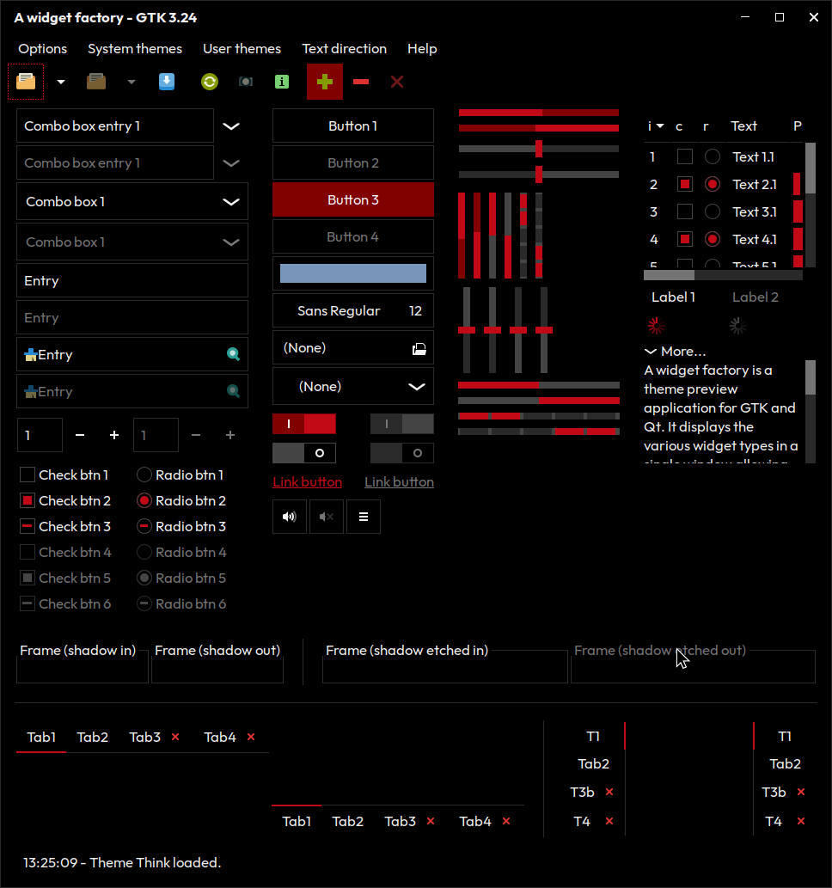

# Think Theme

A minimalist, dark flat theme for GTK3 and xfwm4 with a red accent, inspired by the industrial design of the ThinkPad.

Place the Think folder in your ~/.themes folder (or system-wide equivalent).
To get the complete effect, disable animations and turn on persistent scrollbars by adding this your ~/.config/gtk-3.0/settings.ini:

    [Settings]
    gtk-overlay-scrolling=0
    gtk-enable-animations=0

You may need to alter the settings in your desktop environment (Settings Editor on XFCE). Make sure to also switch the window manager to use the matching theme. Finally, turn off shadows, blur, fading, and transparency.

Font: Outfit

